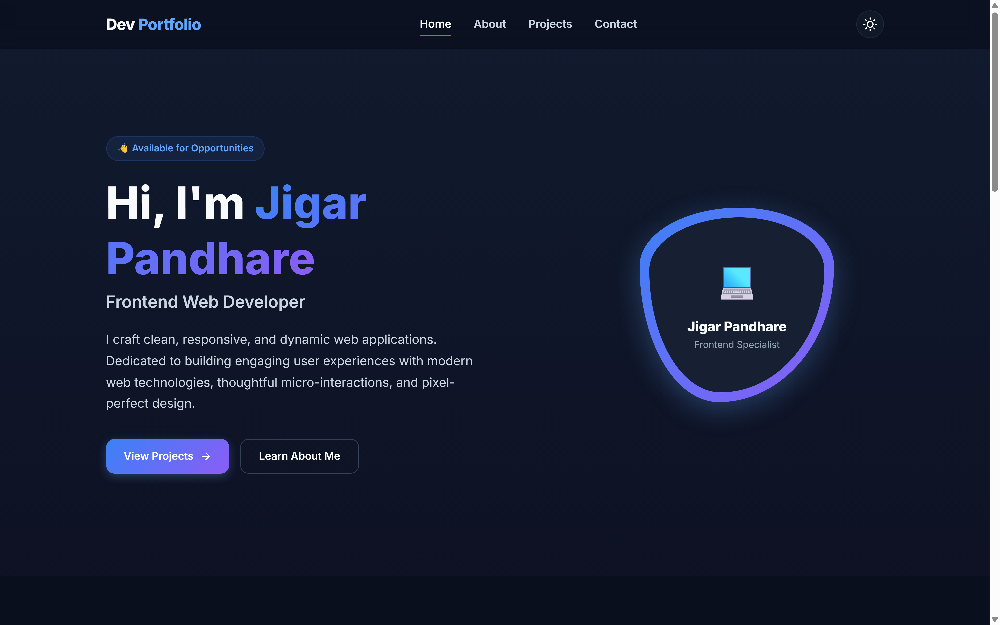
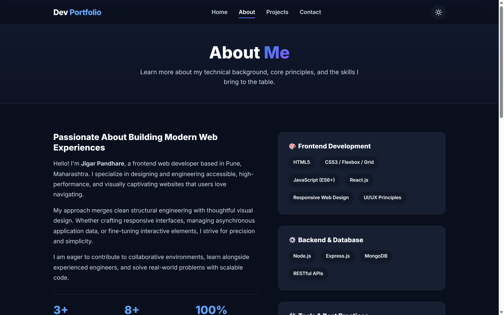
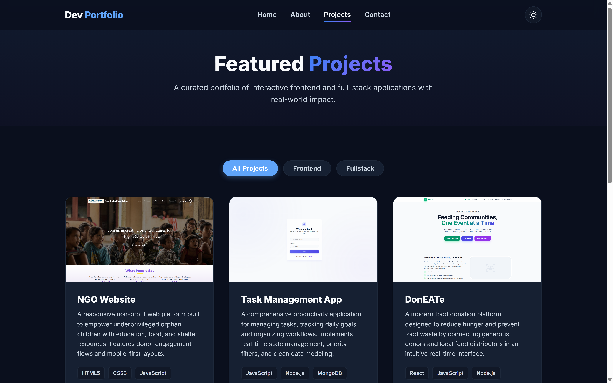
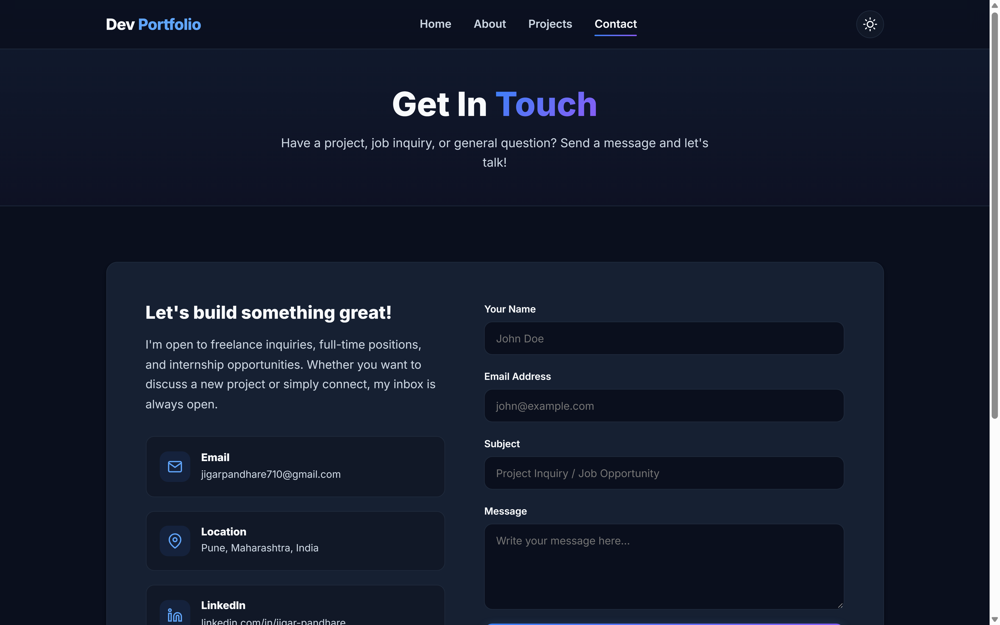
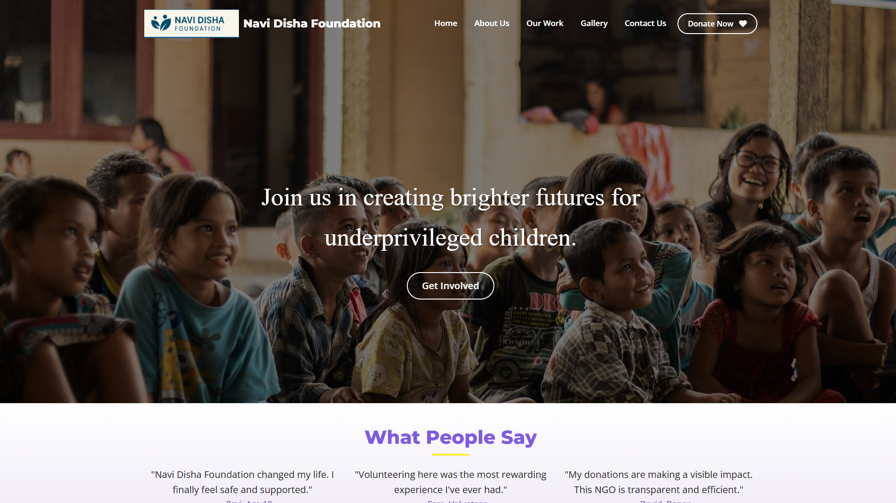
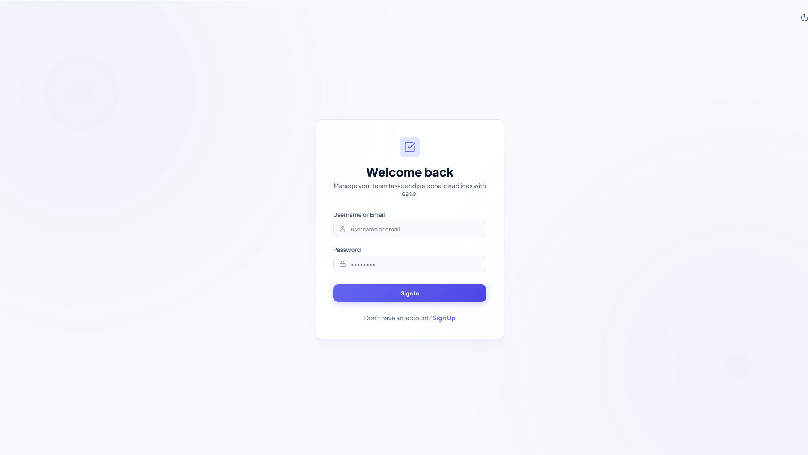
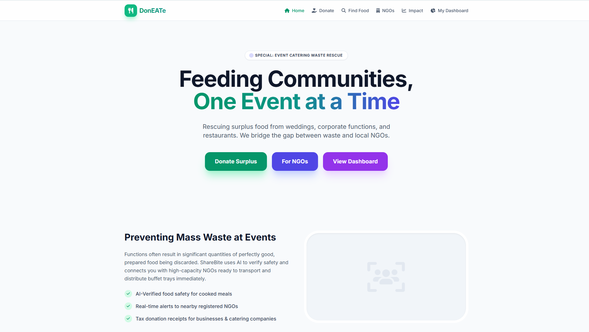

# 🚀 Personal Developer Portfolio

> A modern, responsive, and accessible personal portfolio website built with clean semantic HTML5, modern CSS3, and vanilla JavaScript. Designed to showcase frontend engineering projects, technical skillsets, and professional experience with interactive features and fluid micro-interactions.

---

## 📌 Project Title
**Frontend Developer Portfolio Website**  
*Weintern Assignment-1*

---

## 🎯 Objective
The primary objective of this project is to design and develop a comprehensive, production-ready personal developer portfolio that:
- **Showcases Technical Proficiency**: Demonstrates mastery of core web technologies (semantic HTML5, modern CSS3 styling architectures, and vanilla JavaScript ES6+).
- **Highlights Real-World Projects**: Displays interactive project previews with direct links to live applications and GitHub repositories (NGO Website, Task Management App, and DonEATe).
- **Delivers Flawless User Experience**: Provides a fully responsive, mobile-first design with smooth scroll-reveal animations, category-based project filtering, and persistent dark/light theme switching.
- **Ensures Accessibility & Performance**: Built with clean, accessible markup (ARIA labels, semantic landmarks), fast load times without heavy external dependencies, and responsive layouts across all device viewports.

---

## 💻 Tech Stack

### **Core Technologies**
| Technology | Role / Usage |
| :--- | :--- |
| **HTML5** | Semantic structure, accessibility landmarks (`<header>`, `<nav>`, `<main>`, `<section>`, `<article>`, `<footer>`), and SEO meta tags. |
| **CSS3** | Vanilla CSS, CSS Custom Properties (design tokens for colors, shadows, typography), Flexbox, CSS Grid layouts, and `@keyframes` animations. |
| **JavaScript (ES6+)** | DOM manipulation, theme persistence (`localStorage`), scroll-triggered animations (`IntersectionObserver`), dynamic filtering, and interactive form handling. |

### **Typography & Assets**
- **Fonts**: [Google Fonts (Inter)](https://fonts.google.com/specimen/Inter) for clean, modern readability.
- **Icons**: Handcrafted scalable vector graphics (SVG) for theme toggle, social links, contact cards, and action buttons.

### **Version Control & Hosting**
- **Version Control**: Git & GitHub
- **Deployment**: GitHub Pages (Continuous Deployment)

---

## ✨ Features Implemented

### 🌓 1. Dark & Light Theme Switcher
- Seamless toggle button in the navigation header with animated Sun/Moon icons.
- **Theme Persistence**: Saves user preference in browser `localStorage` so the selected theme remains active across page refreshes and navigation.
- **System Preference Detection**: Automatically checks and honors system-level color schemes (`prefers-color-scheme: dark`).

### 📱 2. Mobile-First Responsive Design
- Fully responsive layout adapting across mobile devices (<768px), tablets (768px–1024px), and desktop screens (>1024px).
- Dynamic mobile navigation featuring an animated hamburger menu with smooth transitions and click-outside/link-click auto-close behavior.

### 🔍 3. Interactive Project Filtering
- Real-time categorical filtering on the **Projects** page (`All`, `Frontend`, `Fullstack`).
- Animated transitions with smooth CSS fade-and-slide keyframes (`@keyframes fadeInCard`) when toggling between categories.

### ✨ 4. Scroll-Triggered Reveal Animations
- Smooth viewport entry animations leveraging the high-performance `IntersectionObserver` API.
- Progressive enhancement with a fallback scroll listener for legacy browser support.

### 📄 5. Multi-Page Structure
- **Home (`index.html`)**: Hero section with status indicator badge, introduction, "What I Do" service cards, featured project highlights, and call-to-action (CTA) banner.
- **About (`about.html`)**: Detailed developer bio, key achievement metrics, categorized skills breakdown (Frontend, Backend & Database, Tools), resume download button, and education/experience milestone timeline.
- **Projects (`projects.html`)**: Curated showcase of featured applications with category filters, technology pills, and live demo / GitHub links.
- **Contact (`contact.html`)**: Direct contact channels (Email, Location, LinkedIn) and an interactive message form.

### 📬 6. Interactive Contact Form with Validation
- Client-side validation ensuring valid inputs before submission.
- Real-time feedback state displaying a loading indicator (`Sending...`) followed by a success confirmation message and automatic form reset.

### 🎯 7. Dynamic Active Navigation Indicator
- Automatically parses `window.location.pathname` to highlight the current active page in the navigation bar.

### 📅 8. Dynamic Copyright Year
- JavaScript-driven dynamic footer year computation ensuring the copyright notice stays automatically up-to-date.

---

## 📂 Folder Structure

```text
portfolio-website/
├── assets/
│   ├── icons/                         # Scalable SVG vector icons
│   │   ├── external-link.svg
│   │   ├── github.svg
│   │   ├── instagram.svg
│   │   ├── linkedin.svg
│   │   ├── mail.svg
│   │   ├── map-pin.svg
│   │   ├── moon.svg
│   │   └── sun.svg
│   └── images/                        # Project screenshot previews and assets
│       ├── ngo-website.png            # NGO Website project preview
│       ├── task-manager.png           # Task Management App project preview
│       └── doneate.png                # DonEATe platform project preview
├── css/
│   └── style.css                      # Comprehensive CSS styling & design system
├── js/
│   └── script.js                      # Application logic and UI interactions
├── index.html                         # Homepage
├── about.html                         # About Me & Skills page
├── projects.html                      # Projects showcase & filter page
├── contact.html                       # Contact form & communication channels
└── README.md                          # Project documentation
```

---

## 🛠️ Setup or Run Instructions

Follow these simple steps to run the portfolio locally on your machine:

### **Prerequisites**
You only need a modern web browser (e.g., Google Chrome, Mozilla Firefox, Microsoft Edge, or Safari).

### **Step 1: Clone the Repository**
Open your terminal or command prompt and clone the project:
```bash
git clone https://github.com/jigarpandhare25/Weintern-Assignment-1.git
```

### **Step 2: Navigate to the Project Directory**
```bash
cd Weintern-Assignment-1/portfolio-website
```

### **Step 3: Run the Website**

Choose any of the following convenient methods:

#### **Method 1: Direct File Open (Quickest)**
Double-click `index.html` or open it directly in your web browser:
```bash
# On Windows
start index.html

# On macOS
open index.html

# On Linux
xdg-open index.html
```

#### **Method 2: VS Code Live Server Extension (Recommended for Development)**
1. Open the project folder in **Visual Studio Code**.
2. Install the **Live Server** extension (by *Ritwick Dey*) if not already installed.
3. Right-click on `index.html` and select **"Open with Live Server"**.
4. The site will launch automatically at `http://127.0.0.1:5500/index.html` with hot-reloading enabled.

#### **Method 3: Python Built-in HTTP Server**
If Python is installed on your computer, run:
```bash
python -m http.server 8000
```
Then visit `http://localhost:8000/index.html` in your browser.

#### **Method 4: Node.js Serve**
If Node.js is installed, you can use `npx serve`:
```bash
npx serve .
```

---

## 🌐 Live Project Link

- **Live Website**: [https://jigarpandhare25.github.io/Weintern-Assignment-1/portfolio-website/](https://jigarpandhare25.github.io/Weintern-Assignment-1/portfolio-website/)
- **Source Code Repository**: [https://github.com/jigarpandhare25/Weintern-Assignment-1](https://github.com/jigarpandhare25/Weintern-Assignment-1)

---

## 📸 Screenshots

### 🖥️ Portfolio Web Pages

#### **1. Home Page (`index.html`)**

*Modern hero presentation, live status indicator, "What I Do" competencies, and featured project previews.*

---

#### **2. About Me Page (`about.html`)**

*Detailed developer narrative, categorized technical skill stacks (Frontend, Backend, Tools), and academic milestones.*

---

#### **3. Projects Page (`projects.html`)**

*Interactive category filtering (All, Frontend, Fullstack), technology tags, live demo links, and GitHub repository links.*

---

#### **4. Contact Page (`contact.html`)**

*Functional contact form with client-side validation, direct contact channels, and social media connectivity.*

---

### 🚀 Featured Project Showcases

#### **1. NGO Website Project Preview**

*A responsive platform designed to empower underprivileged orphan children with nutrition, shelter, and educational support.*

---

#### **2. Task Management Application Preview**

*A full-stack productivity web application featuring priority categorization, real-time status tracking, and clean workflow management.*

---

#### **3. DonEATe Food Donation Platform Preview**

*A community food rescue platform connecting surplus food donors with distribution networks to combat hunger and minimize waste.*

---

## 👨‍💻 Author Details

- **Author**: **Jigar Pandhare**
- **Role**: Frontend Web Developer
- **Location**: Pune, Maharashtra, India
- **Email**: [jigarpandhare710@gmail.com](mailto:jigarpandhare710@gmail.com)
- **LinkedIn**: [linkedin.com/in/jigar-pandhare-74bb83329](https://www.linkedin.com/in/jigar-pandhare-74bb83329/)
- **GitHub**: [github.com/jigarpandhare25](https://github.com/jigarpandhare25)
- **Instagram**: [@_.jigarrr._25](https://www.instagram.com/_.jigarrr._25/)
- **Resume**: [View Resume on Google Drive](https://drive.google.com/file/d/1JEJuZ-dbB-IAQYMxXFcYIGZk_2DoCgCa/view?usp=sharing)

---

*Created with ❤️ by Jigar Pandhare for Weintern Assignment-1.*
